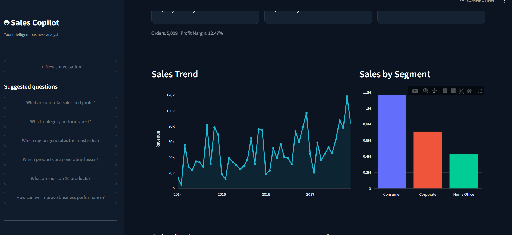
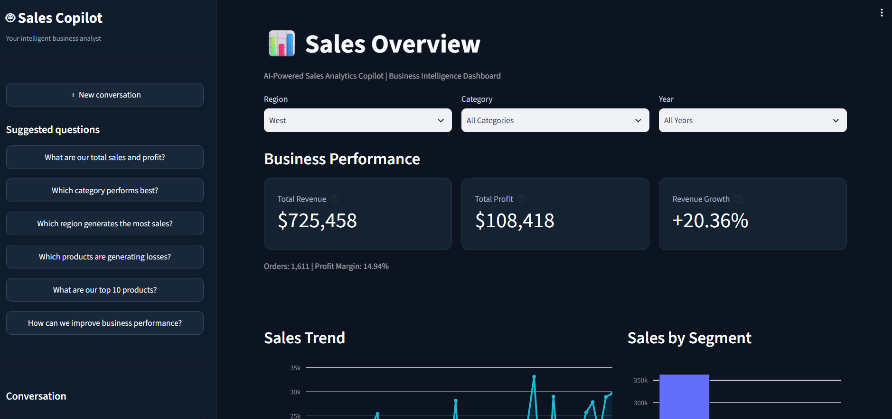
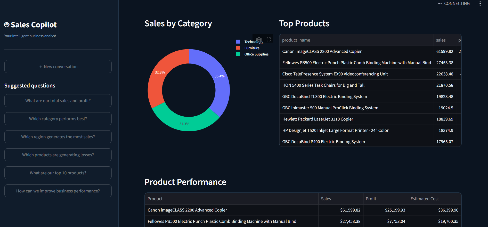
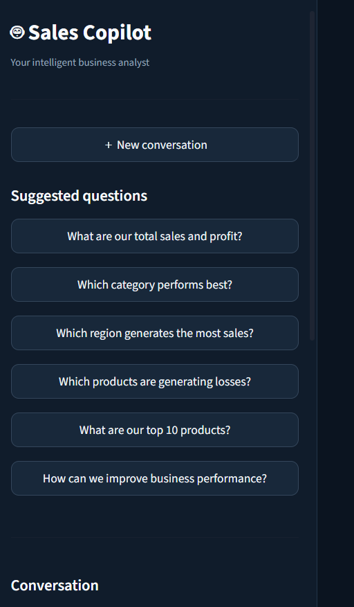
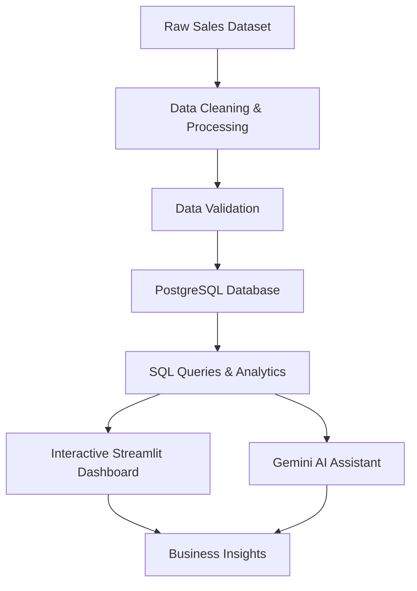

# 🚀 AI-Powered Sales Analytics Copilot

### An End-to-End Data Analytics, Engineering & AI-Powered Business Intelligence Application

An intelligent business analytics platform that transforms raw sales data into actionable business insights through automated data processing, exploratory data analysis, PostgreSQL integration, interactive dashboards, and a Gemini-powered AI assistant.

The project demonstrates an end-to-end analytics workflow — from raw data extraction and cleaning to database management, business intelligence, and conversational AI.

---

## 📸 Application Preview

### Main Analytics Dashboard


### Sales Performance & Trend Analysis



### Regional Performance Analysis



### Product & Category Analysis



### AI-Powered Analytics Assistant



---

## 🎯 Project Overview

Businesses generate large volumes of sales data, but transforming that data into meaningful insights requires efficient data processing, reliable storage, analytical capabilities, and accessible reporting tools.

The AI-Powered Sales Analytics Copilot addresses this challenge by integrating data engineering, business intelligence, and generative AI into a unified application.

The platform enables users to explore sales performance, monitor key business metrics, analyze regional and product-level performance, and interact with an AI assistant to understand their business data through natural language.

## ✨ Key Features

- **Automated Data Processing:** Clean, transform, and prepare raw sales data using Python and Pandas.
- **Exploratory Data Analysis:** Analyze sales patterns, profitability, product performance, and regional trends.
- **PostgreSQL Integration:** Store and retrieve structured sales data using a relational database.
- **Interactive Analytics Dashboard:** Explore business performance through dynamic visualizations and KPI metrics.
- **Dynamic Data Filtering:** Filter analytical results by region, product category, and year.
- **AI-Powered Analytics Assistant:** Use Google Gemini to interact with sales data and obtain conversational business insights.
- **Data Validation:** Verify processed data and analytical results against database calculations.
- **Business Intelligence:** Turn historical sales information into meaningful performance indicators.

## 🛠️ Technology Stack

| Category | Technologies |
|---|---|
| Programming Language | Python |
| Data Manipulation | Pandas, NumPy |
| Data Visualization | Plotly, Matplotlib, Streamlit |
| Database | PostgreSQL |
| Database Connectivity | SQLAlchemy |
| Generative AI | Google Gemini API |
| Application Framework | Streamlit |
| Development Tools | VS Code, Jupyter Notebook |
| Version Control | Git, GitHub |

## 🏗️ System Architecture

The application follows an end-to-end data analytics workflow:



## 🔄 Data Engineering Workflow

**1. Data Ingestion**

Import the raw Superstore sales dataset into the analytics environment.

**2. Data Cleaning & Transformation**

Use Python and Pandas to process the dataset, handle data quality issues, and prepare structured analytical data.

**3. Data Validation**

Validate the processed dataset and compare key analytical metrics with database query results.

**4. Database Integration**

Load the cleaned sales data into PostgreSQL for structured storage and analytical querying.

**5. Data Analysis**

Perform exploratory data analysis and calculate business performance indicators using Python and SQL.

**6. Dashboard Development**

Present analytical results through an interactive Streamlit dashboard.

**7. AI Integration**

Connect the Gemini API to provide a conversational interface for exploring sales information and generating business insights.

## 📊 Dataset & Business Metrics

**Dataset:** Superstore Sales Dataset

**Dataset size:** 9,994 records

The project analyzes key business performance indicators, including:

- Total Sales / Revenue
- Total Profit
- Sales Trends
- Regional Performance
- Product Category Performance
- Yearly Business Performance
- Sales and Profitability Patterns

### Validated Dataset Results

| Metric | Value |
|---|---:|
| Total Records | 9,994 |
| Total Sales | $2,297,200.86 |
| Total Profit | $286,397.02 |

These figures were validated against the PostgreSQL analytical results.

## 🤖 AI-Powered Analytics Assistant

The application integrates Google's Gemini API to provide a natural-language interface for business analytics.

Users can interact with the assistant to explore business performance and ask analytical questions without manually writing SQL queries.

Example questions:

- Which region generates the highest sales?
- What are the key sales performance trends?
- Which product categories contribute to profitability?
- What business insights can be derived from the sales data?

The AI assistant makes analytical information more accessible through conversational interaction.

## 📁 Project Structure

```text
AI-POWERED-SALES-ANALYTICS-COPILOT/
│
├── data/
│   ├── raw/
│   │   └── Superstore.csv
│   └── processed/
│       └── superstore_cleaned.csv
│
├── notebooks/
│   └── 01_sales_eda.ipynb
│
├── src/
│   └── pipeline.py
│
├── reports/
│   └── figures/
│
├── screenshots/
│   ├── dashboard.png
│   ├── sales_overview.png
│   ├── regional_analysis.png
│   ├── product_analysis.png
│   └── ai_assistant.png
│
├── tests/
│
├── app.py
├── requirements.txt
├── .env
├── .gitignore
└── README.md
```

## ⚙️ Installation & Setup

### Prerequisites

- Python 3.10 or later
- PostgreSQL
- Git
- Google Gemini API key

### 1. Clone the Repository

```bash
git clone https://github.com/obaidqureshi99/ai-powered-sales-analytics-copilot.git

cd ai-powered-sales-analytics-copilot
```

### 2. Create a Virtual Environment

```bash
python -m venv venv
```

Activate it on Windows:

```bash
venv\Scripts\activate
```

### 3. Install Dependencies

```bash
pip install -r requirements.txt
```

### 4. Configure Environment Variables

Create a `.env` file in the project root:

```env
GEMINI_API_KEY=your_gemini_api_key
```

Add your PostgreSQL connection configuration using the variable names expected by the application.

**Security:** Never commit API keys, passwords, or other sensitive credentials to GitHub.

### 5. Configure PostgreSQL

- Install and start PostgreSQL.
- Create the required database.
- Configure the database connection.
- Execute the project's data pipeline to prepare and load the dataset.

### 6. Run the Data Pipeline

Execute the pipeline using the entry point configured in the project:

```bash
python src/pipeline.py
```

### 7. Launch the Application

```bash
streamlit run app.py
```

Open the local Streamlit URL displayed in your terminal.

## 🔍 Skills Demonstrated

This project demonstrates practical experience in:

- Python Programming
- Data Cleaning & Preprocessing
- Exploratory Data Analysis (EDA)
- SQL & PostgreSQL
- Data Engineering Fundamentals
- ETL / Data Processing Pipelines
- Data Visualization
- Business Intelligence
- Generative AI Integration
- API Integration
- Interactive Dashboard Development
- Data Validation

## 🚀 Future Enhancements

- Integrate automated ETL scheduling.
- Implement advanced sales forecasting using machine learning.
- Add customer segmentation and RFM analysis.
- Develop more advanced conversational text-to-SQL capabilities.
- Introduce role-based access and authentication.
- Deploy the application to a cloud platform.
- Implement advanced business intelligence reporting.

## 👨‍💻 Author

**Obaid Qureshi**

Computer Science Graduate | Aspiring Data Scientist | AI & Machine Learning Enthusiast

Interested in building intelligent data-driven applications, scalable analytics pipelines, and AI-powered business solutions.

- **LinkedIn:** [Obaid Qureshi](https://www.linkedin.com/in/obaid-qureshi-b2a2b8324/)
- **GitHub:** [obaidqureshi99](https://github.com/obaidqureshi99)

---

### ⭐ Support

If you find this project interesting, consider giving the repository a star!

**Built with Python, PostgreSQL, Streamlit, and Generative AI.**